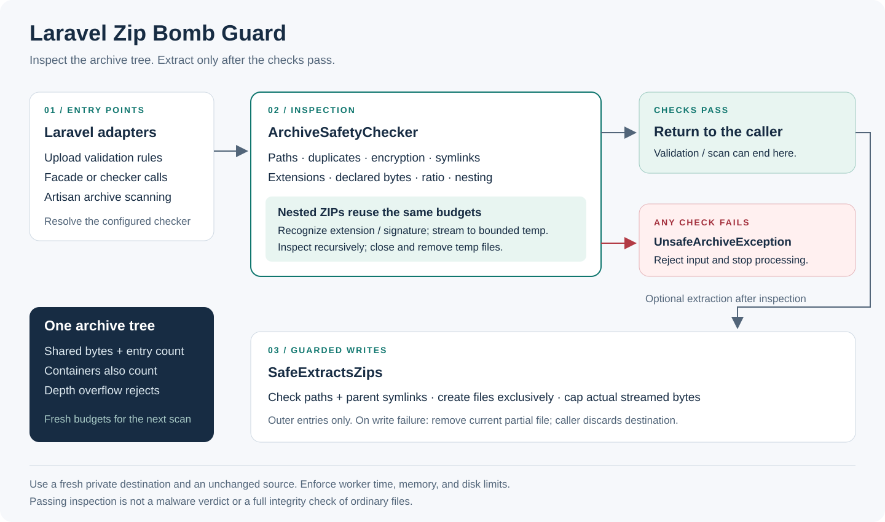

# Laravel Zip Bomb Guard

[](https://github.com/dineshuprety/laravel-zip-bomb-guard/actions/workflows/tests.yml)

Guard your Laravel app against **zip bombs** (decompression bombs), **zip-slip** path traversal, malicious **symlinks**, **nested bombs**, **encrypted payloads**, **duplicate-file swaps**, and **blocked executable extensions** — inspect ZIP-based archives *before* you extract them.

Use it to validate ZIP uploads, inspect export bundles, and extract archives in queue workers with configurable limits.

## Documentation

- [Usage guide](docs/usage.md): upload validation, extraction cleanup, and CLI exit codes.
- [Configuration and troubleshooting](docs/configuration.md): environment variables, shared budgets, and inspection limits.
- [Architecture](docs/architecture.md): component boundaries, shared budgets, and failure cleanup.
- [Contributing](CONTRIBUTING.md): development setup, regression tests, and pull requests.
- [Support](SUPPORT.md), [security reporting](SECURITY.md), and [Code of Conduct](CODE_OF_CONDUCT.md).
- [Maintainer guide](docs/maintaining.md): reviewed releases, immutable tags, and Packagist registration.

---

## How it works



Every entry point — an upload form, an export job, or a queue worker — passes through the same engine: `ArchiveSafetyChecker`. It checks entry metadata from the ZIP central directory and reads a short prefix of unencrypted files to recognize renamed ZIPs. Nested archives are decompressed to temporary files under the byte cap and checked recursively. File and byte budgets are shared across the entire archive tree and reset for each top-level scan. The first failed check throws `UnsafeArchiveException`; archives deeper than the configured limit are rejected.

---

## Requirements

- PHP 8.2+ for Laravel 12, or PHP 8.3+ for Laravel 13
- PHP `ext-zip`

## Install

Install the tagged release directly from this GitHub repository until the package is registered on Packagist:

```bash
composer config repositories.zip-bomb-guard vcs https://github.com/dineshuprety/laravel-zip-bomb-guard
composer require dineshuprety/laravel-zip-bomb-guard:^1.0
```

The service provider and the `ZipBombGuard` facade auto-register. Optionally publish the config:

```bash
php artisan vendor:publish --tag=zip-bomb-guard-config
```

After Packagist registration, new projects can omit the `composer config repositories...` command.

---

## Usage

### 1. Facade

```php
use ZipBombGuard;

ZipBombGuard::assertSafe($archivePath); // throws UnsafeArchiveException if a safety check fails
ZipBombGuard::isSafe($archivePath);     // true / false
```

### 2. Validation — string rule

The fastest way to protect an upload endpoint:

```php
$request->validate([
    'archive' => ['required', 'file', 'mimes:zip', 'no_zip_bomb'],
]);
```

### 3. Validation — rule object

For FormRequests and explicit rule arrays:

```php
use DineshUprety\ZipBombGuard\Rules\NoZipBomb;

public function rules(): array
{
    return [
        'archive' => ['required', 'file', 'mimes:zip', new NoZipBomb],
    ];
}
```

An archive that fails a check is rejected with a validation message. PHP may already have stored the upload in its temporary directory, and nested archive inspection also uses temporary files.

### 4. Check any archive in code

```php
use DineshUprety\ZipBombGuard\ArchiveSafetyChecker;
use DineshUprety\ZipBombGuard\Exceptions\UnsafeArchiveException;

$checker = app(ArchiveSafetyChecker::class); // limits from config

try {
    $checker->assertSafe($archivePath);
} catch (UnsafeArchiveException $e) {
    Log::warning('Rejected unsafe archive', ['why' => $e->getMessage()]);
    return;
}
```

### 5. Extract safely in jobs

```php
use DineshUprety\ZipBombGuard\Concerns\SafeExtractsZips;

class ProcessExportArchive implements ShouldQueue
{
    use SafeExtractsZips;

    public function handle(): void
    {
        $this->extractSafely($this->archivePath, $this->destination);
    }
}
```

Three layers: the central-directory scan, a resolved-path zip-slip guard, and byte-counted streaming extraction that aborts mid-write the moment the ceiling breaks.

Use a fresh destination directory outside your public web root, writable only by the worker. Existing files and symlink parent directories are rejected. A failed extraction removes the current partial file; earlier completed files may remain, so discard the destination after an exception. Keep the source archive unchanged between inspection and extraction.

### 6. Audit the server

```bash
php artisan zip-bomb:scan storage/app/uploads
php artisan zip-bomb:scan storage/app/backups --fail-on-unsafe   # non-zero exit for CI
```

Scans one archive or every `.zip`/`.jar`/`.war`/`.docx`/`.xlsx`/`.pptx` in a directory recursively, printing `SAFE` / `UNSAFE` with the reason for each.

---

## The 8 security checks

| # | Check | What it catches |
|---|-------|-----------------|
| 1 | Zip-slip path rejection | `..`, absolute paths, drive letters escaping the destination |
| 2 | Duplicate filenames | Later entries silently overwriting earlier ones (swap attack) |
| 3 | Encrypted entries | Password-protected zips — a favorite malware carrier |
| 4 | Symlink detection | Symlinks pointing outside the extraction folder |
| 5 | Blocked extensions | `.php`, `.phtml`, `.phar`, `.sh`, `.exe`, etc. never land on your server |
| 6 | Total uncompressed size ceiling | A bomb announces itself here (42 KB claiming petabytes) |
| 7 | Compression-ratio heuristic | Real files rarely beat 20:1; a bomb sits near 1,000,000:1 |
| 8 | Recursive nested-archive scan | A zip inside a zip gets streamed to temp under the byte cap and checked the same way |

## Configuration

| Key | Default | Meaning |
|---|---|---|
| `max_total_bytes` | 100 MiB | Sum of declared uncompressed sizes across the entire nested tree, including ZIP container entries |
| `max_files` | 1000 | Total entry count across the entire nested tree |
| `max_ratio` | 20 | Uncompressed : compressed ratio per entry |
| `max_nesting_depth` | 3 | Maximum nested depth; deeper archives are rejected (0 rejects all nested archives) |
| `reject_encrypted` | true | Reject password-protected entries |
| `reject_symlinks` | true | Reject symlink entries |
| `blocked_extensions` | php, phtml, phar, sh, exe, bat, cmd, com, scr | Extensions never allowed inside archives |

Override per environment with `ZIP_BOMB_GUARD_MAX_BYTES`, `ZIP_BOMB_GUARD_MAX_FILES`, `ZIP_BOMB_GUARD_MAX_RATIO`, `ZIP_BOMB_GUARD_MAX_NESTING`, `ZIP_BOMB_GUARD_REJECT_ENCRYPTED`, `ZIP_BOMB_GUARD_REJECT_SYMLINKS`.

For example, an outer ZIP containing two ZIPs with 10 files each consumes 22 entries. Its byte budget includes both inner ZIP files and their 20 decompressed entries. Nested streams cannot exceed their declared size. This makes the limits stricter than the initial development snapshot, which reset them per archive.

Also enforce upload size limits and worker time, memory, and disk limits. Nested inspection recognizes `.zip`, `.jar`, `.war`, `.docx`, `.xlsx`, and `.pptx` by extension, plus renamed files beginning with a standard ZIP signature. Renamed self-extracting/prefixed ZIPs and other archive formats are not detected by the prefix check. Ordinary files are not fully decompressed during inspection, and encrypted content cannot be inspected if encrypted entries are explicitly allowed. A passing scan is not a malware verdict, and the extension blocklist does not cover every executable file type.

---

## Tests

```bash
composer install
vendor/bin/phpunit
```

Tests cover safe and unsafe archives, shared recursive budgets, renamed nested ZIPs, encrypted and malformed archives, size and compression limits, nesting limits, ZIP symlinks, duplicate filenames, blocked extensions, safe extraction, destination symlinks, overwrite protection, failed writes, temporary/partial-file cleanup, Laravel configuration, validation rules, the facade, and the scan command. GitHub Actions tests Laravel 12 and 13 across supported PHP 8.2–8.5 combinations and runs `composer audit`. Dependabot checks Composer dependencies and GitHub Actions weekly.

## License

[MIT](LICENSE)
